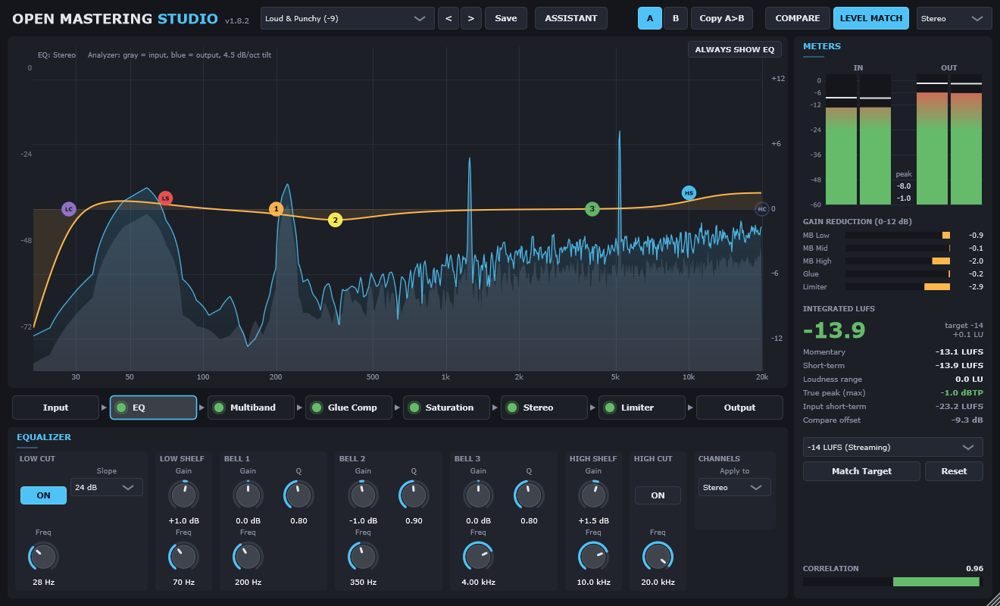

# Open Mastering Studio (VST3 + Standalone)

A complete mastering chain for Windows: EQ, multiband compression, glue compression, saturation, stereo imaging, a true-peak limiter and dither. It has EBU R128 / BS.1770 loudness metering, a spectrum analyzer with draggable EQ points, level-matched A/B comparison and, in the standalone app, file playback and export.



**Download:** get the latest version from the [Releases](https://github.com/aloomens/open-mastering-studio/releases) page (the program zip, plus the source zip).

## License: free software (GNU AGPLv3)

Open Mastering Studio is free software, released under the **GNU Affero General Public License version 3** (see [LICENSE.txt](LICENSE.txt)). Copyright (C) 2026 Al Oomens.

- **You may** use it for anything, including commercial mastering work, and share it with anyone, for free or not.
- **If you share it**, pass on the license and offer the source code. The simplest way is to share the source zip (`OpenMasteringStudio-<version>-source.zip`) next to the program zip.
- **If you change it and share your version** (or run it for others over a network), your changes must be released under the same license.
- **There is no warranty.** See the license for the exact terms.

It is built with JUCE (AGPLv3) and the Steinberg VST3 and ASIO SDKs (both used under GPLv3); see [THIRD-PARTY-NOTICES.txt](THIRD-PARTY-NOTICES.txt). Click the **OPEN MASTERING STUDIO** title in the app or plugin to see the license notice.

The source package contains everything needed to build: this folder plus JUCE 8.0.4 and the ASIO SDK under `external/`. Build with Visual Studio 2022 (Build Tools) and CMake, as described below. Unpack it to a short path such as `C:\src`: deep folders push the compiler's working files past Windows' 260-character path limit, and the build fails.

## Help & feedback

- **Questions** ("how do I...?"): [Discussions Q&A](https://github.com/aloomens/open-mastering-studio/discussions/categories/q-a).
- **Ideas and feature requests:** [Discussions Ideas](https://github.com/aloomens/open-mastering-studio/discussions/categories/ideas), where others can upvote them, or a [feature request](https://github.com/aloomens/open-mastering-studio/issues/new/choose).
- **Problems:** a [bug report](https://github.com/aloomens/open-mastering-studio/issues/new/choose). Please include the Open Mastering Studio version (next to the title), your DAW, your Windows version and the steps that show the problem.
- **Email:** [openstudio.plugins@gmail.com](mailto:openstudio.plugins@gmail.com), for anything, especially if you don't have a GitHub account.

## Builds

| | Path |
|---|---|
| **VST3 plugin** | `build\MasteringStudio_artefacts\Release\VST3\Open Mastering Studio.vst3` |
| **Standalone app** | `build\MasteringStudio_artefacts\Release\Standalone\Open Mastering Studio.exe` |

Install the plugin from an **administrator** PowerShell, then rescan plugins in your DAW:

```powershell
Copy-Item -Recurse -Force "C:\Code\MasteringStudio\build\MasteringStudio_artefacts\Release\VST3\Open Mastering Studio.vst3" "C:\Program Files\Common Files\VST3\"
```

The standalone `.exe` is a single file; copy it anywhere.

The version shows next to the **OPEN MASTERING STUDIO** title in both the app and the plugin, and in the standalone window's title bar. Windows shows the same version under right-click → Properties → Details for both files. Before 1.6.2, those Properties wrongly said 1.2.0.

### 1.8.1

- **A look shared with Clean Tone Studio and Open Vocal Studio.** The title (OPEN MASTERING in white, STUDIO in blue) is larger, with the version right after it. Panel titles (EQUALIZER, METERS, MASTER ASSISTANT and the rest) are blue with a short underline.
- **Buttons follow one rule in all three:** buttons that stay lit are in capitals (ON, COMPARE, LEVEL MATCH, ASSISTANT, ALWAYS SHOW EQ, LOOP, LEARN, LISTEN, BYPASS, SOLO, LIN. PHASE and the other switches); buttons that do something once are not (Save, Copy A>B, Open..., Export Master..., Analyze & Apply). The Assistant's hints name the buttons as they read: "press LEARN", "press STOP LEARNING".
- At the smallest window size (1200 px wide) the preset box is narrower, so a long preset name can wrap onto two lines.
- No change to the audio; sessions and presets load as before.

### 1.8.0

- **Renamed Open Mastering Studio** to avoid confusion with other products. It's the same plugin: its plugin ID hasn't changed, so DAW sessions made with "Mastering Studio" load it as before.
- **Upgrading:** Install VST3.bat removes the old `Mastering Studio.vst3`, so your DAW doesn't list the plugin twice. If you install by hand, delete that folder yourself. Your saved presets are copied from `Documents\Mastering Studio\Presets` to `Documents\Open Mastering Studio\Presets` the first time you open the plugin, and the old folder is left as it was. The standalone app keeps its audio settings under the new name, so choose your audio device again once.
- **Copyright** is now in the name of Al Oomens.
- No change to the audio.

### 1.7.5

- **Released as free software under the GNU AGPLv3.** The full source code, including JUCE and the ASIO SDK, now ships as a separate source zip.
- **About box:** click the title to see the version, copyright, license and no-warranty notice.
- **THIRD-PARTY-NOTICES.txt corrected:** earlier versions wrongly said the bundled VST3 SDK was MIT-licensed. The version bundled with JUCE 8.0.4 is offered under the Steinberg VST3 License or GPLv3, and the plugin uses it under GPLv3.
- No change to the audio.

### 1.7.4

- **Tape (Modeled) uses about 40 % less CPU on normal material.** THE_LAB showed that 1.7.2's change made it *heavier* on ordinary signals: 3489 ns/sample for the whole plugin with Loud & Punchy, against 2265 in 1.7.1. The 4th-order solver did 4 evaluations per step and was no cleaner. 1.7.4 goes back to the 2-evaluation solver with 1.7.1's fine step, keeps 1.7.2's cheaper inner formula, and caps the steps at 4 per sample. Saturation stage alone at 48 kHz, drive 5: a steady tone 3.0 → 1.7 µs/sample, music 3.2 → 1.9 µs/sample. On extreme full-band noise the worst 512-sample buffer is about 4–5 ms (1.7.1: 66 ms). Aliasing is unchanged at −122 dB on both of THE_LAB's high notes.

### 1.7.2

- **Tube aliasing fixed (both Tube types).** THE_LAB measured a −78 dB spur at 22.8 kHz from a 6.3 kHz tone. The oversampler's last filter let the 4th harmonic (25.2 kHz) fold back. It's been there since 1.0, and the strong even harmonics of Tube (Modeled) made it show. That filter is now three times steeper with a deeper stopband: the same test reads −130 dB. It stays linear-phase, so Mix still lines up exactly. The steeper filter is longer, so the base latency grows from 233 to 362 samples at 48 kHz (about 7.5 ms); it's reported to the host as before.
- **Tape (Modeled) worst case bounded.** A hard cap on solver steps per sample took the worst 512-sample buffer on extreme full-band noise from 66 ms (more than the 10.7 ms real-time budget) to about 6 ms. *Correction (1.7.4): the 4th-order solver this release used made normal material about 50 % heavier, not lighter; 1.7.4 fixes that.*
- The test suite now runs THE_LAB's high-note test at both of its tones (6.3 and 10 kHz) for every Tape and Tube type.

### 1.7.1

THE_LAB found aliasing on high notes with **Tape (Modeled)**: a 10 kHz tone produced a −87.8 dB spur at 2 kHz. The hysteresis loop had sharp tips, and their very high harmonics folded back. 1.7.1 rounds the loop tips (as real tape loops are), switches the hysteresis on and off smoothly, and solves the model in finer steps. The same test now reads −122 dB, as clean as the classic curves, and the model's character (distortion vs level and frequency) is unchanged. The test suite now repeats THE_LAB's high-note test.

### New in 1.7.0

Every 1.7 option is off by default, so saved sessions sound exactly as before. The one exception: if a session had dither **Shaping** on, it now uses the better curve. Turn on what you want:

| Module | New option |
|---|---|
| Multiband | **Lin. Phase** crossovers, **Auto Rel.** (program-dependent release) |
| Saturation | **Tape (Modeled)** (magnetic hysteresis with record/playback EQ), **Tube (Modeled)** (level-dependent bias) |
| Stereo | **Mono Bass** with its own frequency, **Mono-Safe** width, **Lin. Phase** crossovers |
| Limiter | **Style: Transparent** (longer look-ahead, program-dependent release, smoother gain) |
| Dither | **Shaping** now uses a 9th-order psychoacoustic curve (it was 1st order) |

Rebuild (Visual Studio 2022 Build Tools + CMake):

```powershell
cmake -S . -B build -G "Visual Studio 17 2022" -A x64
cmake --build build --config Release
.\build\MasteringTest_artefacts\Release\MasteringTest.exe   # offline DSP / export tests
pwsh -File Tools\package.ps1   # release zips (program + source) in dist\ (PowerShell 7)
```

## Signal chain

`Input → EQ → Multiband → Glue Comp → Saturation → Stereo → Limiter → Output → Dither`

Click a module in the chain strip to edit it, and use its LED to switch it on or off. Modules crossfade when switched, so they never click.

| Module | What it does |
|---|---|
| **Input** | Trim into the chain. |
| **EQ** | Low cut (12/24/48 dB/oct), low shelf, 3 bells, high shelf, high cut. Can work on Stereo, Mid only or Side only. Drag the points on the analyzer. They're labeled like the panel: **LC** low cut, **LS** low shelf, **1–3** bells, **HS** high shelf, **HC** high cut. You can also scroll on a bell to change its Q, and double-click to reset the gain (or to switch a cut filter on or off). The filters are modulation-safe, so sweeping them doesn't zip. |
| **Multiband** | 3 phase-aligned Linkwitz-Riley bands (they sum flat), each with threshold, ratio, attack, release, gain, solo and bypass. **LIN. PHASE** switches to linear-phase crossovers with the same 24 dB/oct slopes but no phase shift at the band edges (adds about 90 ms of latency). **AUTO REL.** makes the release program-dependent: fast after short peaks, slow on sustained material, so dense passages don't pump. |
| **Glue Comp** | Stereo-linked soft-knee bus compressor with a sidechain low cut and a parallel mix. |
| **Saturation** | 8× oversampled. **Tape**, **Tube** and **Soft Clip** are fixed curves. **Tape (Modeled)** is a magnetic hysteresis model (Jiles-Atherton) with record pre-emphasis and playback de-emphasis and a gentle head bump: the highs saturate first, and the color depends on level and on what the music just did. **Tube (Modeled)** shifts its bias with the signal, so loud passages "bloom" with more even harmonics while quiet ones stay clean. The small-signal level stays the same, so Drive changes the color rather than the volume. 8× keeps audible aliasing below −83 dB at moderate drive (2× measured about −31 dB). |
| **Stereo** | Mid/side width in 3 bands (0–200 %). **Mono Bass** removes the stereo part below its frequency (24 dB/oct, 40–300 Hz). **MONO-SAFE** turns the widening down whenever it would push the left/right correlation below zero (it never narrows below what the mix already had). **LIN. PHASE** uses linear-phase crossovers: the side is shaped by one zero-phase filter and the mid is only delayed (adds about 90 ms of latency). |
| **Limiter** | Look-ahead brickwall limiter with two styles. **Classic** (1.5 ms look-ahead, one release time) is the 1.6 limiter. **Transparent** uses 3 ms of look-ahead, a program-dependent release (a slow follower holds the average reduction, so the gain recovers fast after a lone peak but does not pump on dense material) and two cascaded smoothing stages, which give an S-shaped gain curve with no corners. Measured on an 80 Hz tone pushed 10 dB into the limiter: −57 dB THD versus −40 dB for Classic. Both use 8× true-peak detection (48-tap interpolation), followed by a second, gentle true-peak stage with a 96-tap detector that catches the small overs the main limiter's own gain changes create. Measured against exact waveform reconstruction, realistic masters hold −0.99 dBTP at a −1.0 ceiling with 6–18 dB of limiting. |
| **Output** | Final trim (which can only lower the level), plus TPDF dither for 24 or 16 bit. **SHAPING** at 44.1/48 kHz uses Wannamaker's 9th-order psychoacoustic (F-weighted) curve: about 18 dB less dither noise in the 1–6 kHz range where hearing is most sensitive, with the excess moved above 15 kHz. At 88.2 kHz and up it moves the noise above 20 kHz. |

Latency is 354–458 samples depending on sample rate (about 7.5–8 ms at 44.1/48 kHz). It comes from the limiter look-ahead, the true-peak stages and the saturation oversampling. Each linear-phase option adds about 90 ms, and the Transparent limiter adds 1.5 ms. Switching one of these while audio plays gives a short, smooth gap (the output fades out, the new delay is reported to the host, and the audio fades back in). It's reported to the host, so your DAW compensates for it automatically, and the test suite confirms the reported value matches the measured delay exactly.

### CPU use of Tape (Modeled)

**Tape (Modeled)** is by far the heaviest setting in the plugin. It solves the magnetic hysteresis equations at the 8× oversampled rate, several times per sample, for each channel. The other saturation types apply a single curve.

| Saturation stage only, 48 kHz (1.7.4) | Average on music | Worst 512-sample buffer |
|---|---|---|
| Tape, Tube, Soft Clip, Tube (Modeled) | about 0.8 µs per sample (≈4 % of one core) | about 1.3 ms |
| Tape (Modeled), drive 5 dB | about 1.9 µs per sample (≈9 % of one core) | about 3 ms |
| Tape (Modeled), drive 15 dB | about 3 µs per sample (≈15 % of one core) | about 5 ms |
| Tape (Modeled), extreme full-band noise | about 6 µs per sample | about 4–5 ms (capped) |

The rest of the plugin adds about 0.4 µs per sample at Loud & Punchy settings. A 512-sample buffer at 48 kHz has 10.7 ms of real time, so one instance runs comfortably. The cost is per sample, so smaller DAW buffers don't change the ratio. The cost per second doubles at 96 kHz.

**Tips:**
- On a slower computer, or with several instances in a session, use classic **Tape** while mixing and switch to Tape (Modeled) for the final bounce. The standalone exporter renders offline, so CPU never causes dropouts there.
- **Drive** raises the cost: the harder the model is pushed, the more solver steps it needs, up to a fixed cap. **Mix** doesn't change it.
- When Saturation is switched off for half a second, the oversampled path rests and costs almost nothing.

## Module views

The chart above the chain strip follows the module you select. Turn on **ALWAYS SHOW EQ** to keep the EQ curve there instead.

| Module | What the chart shows |
|---|---|
| **Input, EQ, Output** | The spectrum analyzer with the EQ curve and its draggable points. |
| **Multiband** | The spectrum split into the three bands, with draggable crossover handles. Live gain reduction hangs from the top of each band, with each band's threshold and ratio underneath. |
| **Glue Comp** | The compressor's input-to-output curve, with a dot showing where the music is right now and a draggable threshold. Next to it, the last 4 seconds of level into the glue (gray), level after reduction (blue) and gain reduction (orange). |
| **Saturation** | The curve being applied, for the chosen type, drive and mix. Shading shows where your signal sits on it, and bars show which harmonics it adds at that level (orange = even, blue = odd). |
| **Stereo** | The spectrum split into the three width bands, with draggable crossovers, each band's width, and a vectorscope: vertical = mono, wide = stereo. |
| **Limiter** | The last 4 seconds of output waveform against the ceiling, with the gain reduction underneath. Orange marks the moments being limited. |

The views run from the same lock-free, allocation-free data feed as the meters, so they add nothing to the audio thread's real-time load.

## Meters (right panel)

- IN/OUT peak meters with peak hold.
- Gain reduction for each multiband band, the glue comp and the limiter.
- **Integrated LUFS** (gated, BS.1770-4), momentary, short-term, loudness range (LRA) and max true peak.
- Correlation.
- **Loudness target** (−8 to −23 LUFS). **Match Target** moves the limiter gain (or the input gain if the limiter is off) by the difference between target and measured loudness. Play the loudest section, click it, then check again.

## Comparing honestly

- **COMPARE** plays the unprocessed input, time-aligned.
- With **LEVEL MATCH** on, the input plays at the same loudness as the master, measured continuously, so you judge tone rather than volume.
- **A / B** are two complete settings slots, and **Copy A>B** duplicates the current one.
- **Monitor** lets you listen in Mono, Side only, Left or Right. It changes only what you hear, not the meters.

## Smooth, click-free changes

You can move every control, including while audio plays, without clicks:

- **Continuous controls** glide over 15–50 ms (gains, frequencies, Q, thresholds, attack/release times, crossovers, limiter gain and ceiling), and the filters glide sample by sample.
- **Switches and choices** crossfade (module on/off, band Solo/Bypass, Monitor, EQ Channels, Low Cut slope, Saturation type, Mono Bass, Mono-Safe, Auto Release). Settings that change the latency (Lin. Phase, Limiter Style) fade out and back in around a short gap.
- **Switched-off modules keep running in the background**, so they're already settled the moment you turn them on.

The test suite checks this: it jumps every parameter across its range, and every switch and choice, while audio plays. It also looks for clicks in the result.

## Measurements

`MasteringTest.exe --lab Reports\measurements.md` measures what the plugin actually does, in the spirit of Phil Speiser's THE_LAB:

- **Harmonic distortion (THD)** at four levels, for each saturation type, the compressors and the limiter.
- **Worst-case aliasing** from a 2–19 kHz sine sweep, both anywhere in the spectrum and below 15 kHz.
- **True-peak output**, measured with an independent 16× oversampled meter rather than the limiter's own detector.
- **Latency** reported to the host versus measured.
- **CPU per module.**

The latest results are in [Reports/measurements.md](Reports/measurements.md). The normal test run checks all of these against limits:

- **Clean path:** no added distortion.
- **Latency:** reported value matches the measured delay exactly.
- **CPU:** under 15% of one core. It measures about 7% at 48 kHz with every module on, and about 4% with saturation off.
- **True peak:** realistic masters stay at or below −0.95 dBTP at a −1.0 ceiling.
- **Real-time safety:** zero memory allocations inside the audio callback. This is checked with a counting allocator across eight scenarios, including moving controls, Learn, standalone file playback and every 1.7 mode on (including toggling linear phase), after THE_LAB flagged per-block parameter lookups in 1.5.0. The linear-phase filters are redesigned on the audio thread when you move a crossover or width, without allocating.
- **1.7 modes** (`MasteringTest.exe --upgrades`): the linear-phase crossovers match the LR4 slopes within 0.01 dB and have symmetric (linear-phase) impulse responses; linear-phase multiband and stereo at neutral settings null against the delayed input below −140 dB; reported latency matches the measured delay in every mode at 44.1/48/96 kHz; Mono Bass takes the side down by 48 dB at 30 Hz and leaves 1 kHz untouched; Mono-Safe keeps the correlation at or above zero; the Transparent limiter holds −1.00 dBTP.
- **Audible aliasing (below 15 kHz):** −75 dB for saturation at moderate drive, −40 dB at extreme drive, −65 dB for the limiter.

True peak is checked against exact band-limited reconstruction (a 256-tap sinc). A general-purpose oversampler like JUCE's reads high or low by up to 1 dB on bright material, so it isn't used as the reference.

**Known limit:** synthetic noise that is flat all the way to 24 kHz can still reach −0.5 to −0.8 dBTP, because peaks built from 22–24 kHz content are very hard to predict. Real masters roll off well below that, and the BS.1770 meters streaming services use read these cases at about −0.96.

## Recalling settings

- **Projects, presets and A/B slots recall exactly.** The test suite renders the same audio both ways and confirms the output is bit-identical.
- **Compare, Level Match and Monitor are left as they are.** They're listening aids, so a session saved while you were in Compare or Mono doesn't reopen sounding different.
- **User presets also store output trim, loudness target and dither**, so they come back exactly as saved. Presets saved before 1.4 don't contain these and leave them unchanged. Factory presets still leave them unchanged.
- **The Compare level match is saved with the session**, so it's correct straight after reopening.

## Presets

Factory presets: Default, Streaming Ready (−14), Loud & Punchy (−9), Warm Analog, Wide & Airy, Bass Control, Gentle Glue and Podcast / Voice (−16).

Your DAW's program/preset display follows along:

- **Factory presets** show by name.
- **User presets, Assistant results and recalled A/B slots** show as *Custom*.
- **Reopened sessions** come back with the program they were saved with.
- **When the DAW re-sends the current program while reopening a session**, your tweaks are kept rather than overwritten.

**Save** stores your own presets in `Documents\Open Mastering Studio\Presets`, including output trim, loudness target and dither. Factory presets leave those three alone. No preset changes Compare, Level Match or Monitor, since those are listening aids.

## Master Assistant

Click **ASSISTANT** in the top bar. While Learn is capturing, that button turns into a blinking red **● LEARNING**, and a badge on the chart shows how much has been captured.

While **Analyze & Apply** runs, a badge on the chart shows **ANALYZING & APPLYING** with a percentage, the current step and a progress bar, and the top-bar button reads **Analyzing NN%**. When it finishes, a notice appears for a few seconds: green **✓ Settings applied** with the new settings' name, or red/gray if it couldn't run or was canceled. The assistant listens to your track and sets up the whole chain as a starting point for a clean, clear, dynamic and loud master. Everything it chooses lands on the normal controls, so you can keep adjusting. **Revert** puts back exactly what you had before.

### 1. Give it the track

- **Standalone app:** load the file in the player and the assistant analyzes the whole file.
- **Plugin, or live input:** press **LEARN**, play the song (the whole song is best, at least 10 seconds), then press **STOP LEARNING**. Silence is skipped, and up to about 5 minutes is captured.

### 2. Choose a target

| Target | Character | How the assistant treats it |
|---|---|---|
| **Pop** | The measured average of popular music | Baseline |
| **Rock** | Slightly darker than pop | Slower glue attack to keep the drums punchy |
| **Hip-Hop / Trap** | Extended sub-bass and a brighter top | Strict mono bass |
| **R&B / Soul** | Lighter low end than hip-hop, softer top than pop | Tube color in Loud style |
| **Electronic / EDM** | Deep bass and the brightest, most extended top | Strict mono bass |
| **Singer-Songwriter** | Voice-led songs with light percussion | Baseline |
| **Acoustic / Folk** | Little sub-bass and a natural top-end decay | Gentle compression, 22 Hz subsonic filter, slow attack |
| **Jazz** | The lightest bottom and darkest top of the measured genres, wide dynamics | Gentle compression, 22 Hz subsonic filter, slow attack |
| **Classical / Orchestral** | Extrapolated (see below) | Most gentle; never adds saturation; leaves natural stereo bass alone |
| **Reference tracks** | The average tonal balance, stereo width and (optionally) loudness of the finished masters you add | Matches those masters |

Sessions saved with 1.1 still open: the old "Acoustic" and "Vocal / Singer-Songwriter" targets map to *Acoustic / Folk* and *Singer-Songwriter*.

#### Where the generic curves come from

All curves are long-term ⅓-octave band levels, normalized to the 200 Hz–4 kHz average. They're built in `targetCurve()` in `Source/Assistant.cpp` from published measurements:

1. **Base shape (Pop):** the mean spectrum of 12,345 popular-music tracks in Elowsson & Friberg, *Long-term Average Spectrum in Popular Music and its Relation to the Level of the Percussion* (AES Convention Paper 9762, 2017), Table 1. The slope is −2.35, −3.67, −4.99, −6.30, −7.62 and −8.94 dB/oct at 200 Hz, 400 Hz, 800 Hz, 1.6 kHz, 3.2 kHz and 6.4 kHz. Those are per-FFT-bin slopes; ⅓-octave bands get wider with frequency, so band levels are 3 dB/oct higher. The Pop curve reproduces the table to within 0.02 dB/oct.
2. **Percussion:** the same paper finds that more percussive tracks have more bass *and* more highs, pivoting around 89 Hz and 4.5 kHz, and that genre differences are "primarily a side-effect" of this. Each curve has a percussion amount (Hip-Hop and EDM +3 dB, Jazz −2 dB, Classical −4 dB, and so on).
3. **Genre tilt:** the 100 Hz–10 kHz spectral slope per genre from Pestana, Ma, Reiss, Barbosa & Black, *Spectral Characteristics of Popular Commercial Recordings 1950–2010* (AES 135th Convention, 2013), Table 2. Relative to pop:

   | Genre | Slope difference |
   |---|---|
   | Electronic | +1.18 dB/oct |
   | Hip-hop | +0.78 dB/oct |
   | Rock | −0.22 dB/oct |
   | R&B / Soul | −0.54 dB/oct |
   | Folk | −1.44 dB/oct |
   | Jazz | −2.10 dB/oct |

   Only 60 % of each difference is used. Those averages also reflect recording era (older material is duller, and the authors note hip-hop's bass and brightness partly reflect post-2000 production). The tilt is applied from about 250 Hz upward, because the paper reports a *lighter* low end for jazz and R&B.
4. **Own judgment, not measured:** the sub-bass amounts, Singer-Songwriter (placed between Pop and Folk), the rule settings in the right-hand column of the table above, and all of **Classical**. Neither paper covers classical music, so its curve extends the low-percussion trend and uses Jazz's tilt.

Neither paper covers speech, so there is no spoken-word curve. The standard speech spectrum (Byrne et al., JASA 1994) would be the source for one.

A reference track of the exact sound you want is still the most precise target.

**Style** sets how loud to go and how much the assistant may compress:

| Style | Target | Average limiting allowed |
|---|---|---|
| **Dynamic** | −16 LUFS | ≤ 0.8 dB |
| **Balanced** | −14 LUFS | ≤ 1.6 dB |
| **Loud** | −10 LUFS | ≤ 3 dB, plus a little saturation |

If reaching the loudness would need more limiting than the style allows, the assistant stops short and explains why.

**Match amount** sets how far the EQ and stereo width move toward the target. Loudness is always matched.

### 3. Reference tracks

Click **Add…** or drop audio files onto the Assistant panel. Each reference is analyzed once, and its profile (tonal balance, loudness, dynamics, width) is saved with your session or project. Select a reference and press **LISTEN** to hear it in place of your master at the same loudness, so you compare tone and dynamics rather than volume. Turn on **USE THEIR LOUDNESS** to aim for the references' loudness instead of the style's. It's still capped to protect dynamics.

### What it does

1. **Measures the mix:**
   - Loudness, true peak and peak-to-loudness ratio.
   - Long-term spectrum in ⅓-octave bands, ignoring quiet passages.
   - How much the bass, mid and high bands vary in level.
   - Stereo width and correlation per band.
   - How transient the material is.
2. **Chooses settings:**
   - **Input level:** sets the input so the mix enters the chain at about −18 LUFS.
   - **EQ:** fits shelves and bells to the difference from the target. Moves are capped at ±3 dB with wide shapes, and the fit prefers fewer, smaller moves. It adds a low cut only when there's excess rumble.
   - **Multiband:** used only when the bass is uneven or the highs are harsh.
   - **Glue:** set for 1–2.5 dB of reduction, with slower attack for transient-rich or acoustic material.
   - **Width:** narrows the bass only if it's wide; widens or narrows the mids and highs only to match a reference.
   - **Limiter:** −1 dBTP true-peak ceiling.
3. **Renders and refines:** it renders the track through the real chain offline, measures the result and adjusts the limiter gain and glue threshold until loudness is within about 0.3 LU. Long songs are refined on eight slices spread through the song, then checked once at full length. A 3-minute song takes about 5 seconds.
4. **Reports:** a list of what changed and why, and a chart of your mix, the target and the result.

## Standalone app

1. **Open…**, or drag a WAV / AIFF / FLAC / MP3 / OGG file onto the window. It plays through the chain, loops by default, and you can click the waveform to seek.
2. Adjust the chain while it plays.
3. Pick a format (WAV 24 / 16 / 32-float, FLAC 24 / 16) and click **Export Master…**. The export renders the whole file offline through the current settings:
   - The latency is trimmed, so the output lines up sample-for-sample with the source.
   - 16- and 24-bit exports are TPDF-dithered automatically.
   - A report shows integrated LUFS, true peak and LRA.

The window can be resized from its corner. Use the **maximise** button in the title bar, or double-click the title bar, to fill the screen.

The app icon is drawn by `Tools\make_icon.ps1`. Run it to regenerate `Resources\icon_big.png` and `icon_small.png` (a simplified version for 16–32 px), then rebuild.

When no file is loaded, the app processes live input. Set the device under **Options → Audio/MIDI Settings…**, which supports ASIO, and untick **Mute audio input**. The yellow "input muted" bar refers only to live input. File playback works with input muted.

ASIO support uses Steinberg's ASIO SDK in `external\asiosdk` (Steinberg ASIO License or GPLv3). If you distribute the app, follow the terms of the license you choose.
